# Powergram

A Telegram client for [Haiku](https://www.haiku-os.org) and
[Renku OS](https://github.com/RenkuOS/Source), written with the native Haiku
API after the GNOME app [Paper Plane](https://github.com/paper-plane-developers/paper-plane).
It talks to Telegram through [TDLib](https://github.com/tdlib/td), Telegram's
own client library, and keeps Paper Plane's layout: the chat list on the left,
the open chat on the right.

**Preview.** Version 0.2.2 is a preview for Haiku and Renku OS (x86_64):
download the `.hpkg` from
[Releases](https://github.com/idumych/Powergram/releases) and install it
with `pkgman install ./powergram-0.2.2-1-x86_64.hpkg`. The app was called
Paper Plane for Haiku up to 0.1.0; Powergram replaces that package and keeps
your login and settings.

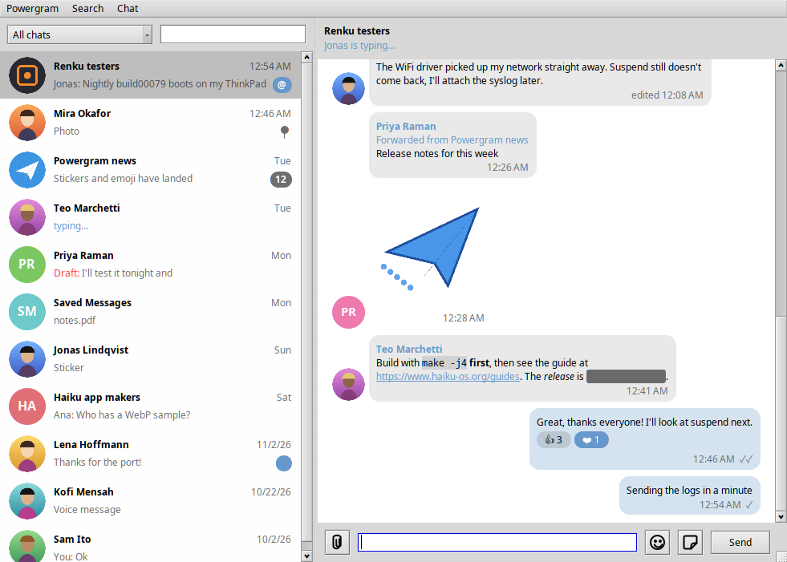

## What works

Built and run on Renku OS and Haiku R1/beta6, x86_64. Used with a real
account (0.1.0): logging in, the chat list, reading chats, photos in chats,
sending and editing messages, emoji, stickers and notifications. Everything
added since 0.2.0, and videos, GIFs, round video messages, sending photos and
files, spoilers and self-destructing photos, has only been checked with
made-up data so far.

- Logging in: phone number, code, cloud password, new accounts
- Your own API key, entered in the login window: it opens my.telegram.org/apps
  in your browser, and pasting the api_id and api_hash lines fills both fields
- Chat list with profile pictures, unread and mention badges, pinned chats,
  drafts, archived chats and chat folders; right-click to mark read or
  unread, mute, pin, archive or delete
- Search: filter the chat list by name, find messages in a chat (Cmd+F, Cmd+G)
- Telegram links and @usernames open in the app: public chats, invite links
  (asking first), links to messages; Chat > Open username or link (Cmd+O);
  a Join button in groups and channels you're not in
- Reading chats: replies, forwards, edits, read ticks, date separators,
  sender pictures in groups, older messages loading as you scroll up; bold,
  italic, code, spoilers and clickable links; opening at the first unread
  message, with a jump-to-latest button; messages of a single emoji shown large
- Selecting text in messages (drag, double- or triple-click) and copying it
- Haiku vector icons (HVIF files) sent in chats, drawn in the message
- Typing, online and "last seen" status and group sizes in the chat header
- Pinned messages: a bar under the chat's name (click to jump, and again for
  the next one); pin and unpin from the message's menu
- Reactions (shown and added), forwarding, polls, locations, places and contacts
- Voice messages, played in the app with a waveform, and recorded: click the
  microphone, then Send (or the microphone again); Escape cancels
- Files and music sent to you, shown with their type's icon, name and size:
  click to open one in its application, or "Save as…" from its menu
- A chat info window: picture, bio or description, members, shared photos
- Settings: notifications, message text in notifications, a sound (chosen in
  the Sounds preferences), text size
- Photos, videos, GIFs, round video messages and stickers (WebP; animated
  stickers show their emoji); spoilers and self-destructing photos
- Sending text, photos, videos (MP4 and QuickTime, with their size and
  length), files (file panel or drag and drop from Tracker) and stickers;
  several photos and videos at once go as an album; replying, editing,
  deleting, copying
- Mentions: typing @ in a group suggests its members (Up, Down, Enter or Tab,
  or a click); people without a username are mentioned by name. An "@" button
  with the count goes to your oldest unread mention
- Emoji and sticker pickers
- Notifications that follow each chat's mute settings
- A Deskbar icon with the number of unread chats: click it to bring Powergram
  forward, drop files on it to send them to a chat you pick (Settings can
  turn it off)
- Read receipts, typing status and online status sent the way the official
  apps send them, and every request throttled (a few at a time, and a full
  stop when Telegram asks to wait)

Not yet: calls, secret chats, QR-code login, video
playback inside the app (videos open in MediaPlayer), a Linux (Cosmoe) build.

## Screenshots

The real app windows filled with made-up chats (`tests/mockup.cpp`); no real
account appears in them.

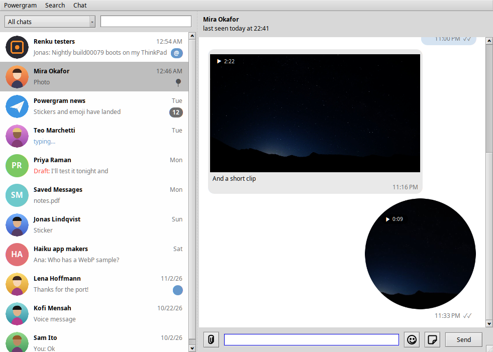
Photos load blurred first; videos show their length; round video messages are drawn round.

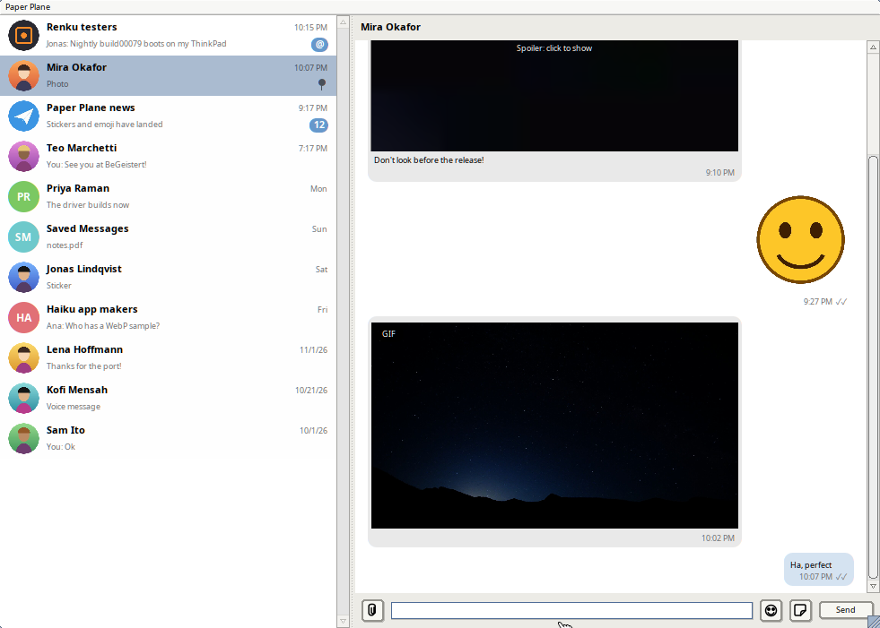
Spoilers stay blurred until clicked; WebP stickers keep their transparency.

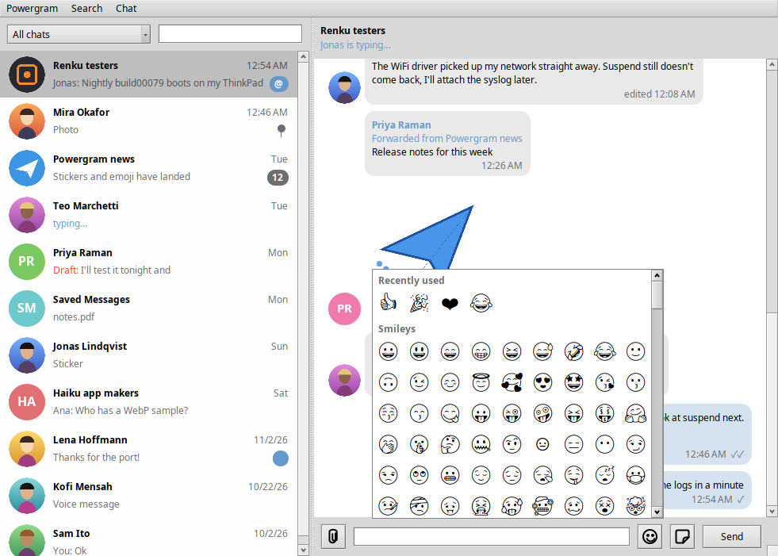
The emoji picker, recently used first.

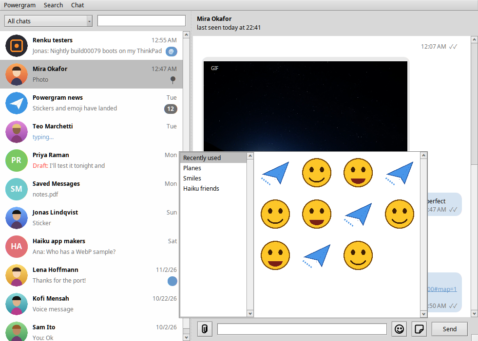
The sticker picker: your sets on the left, their stickers on the right.

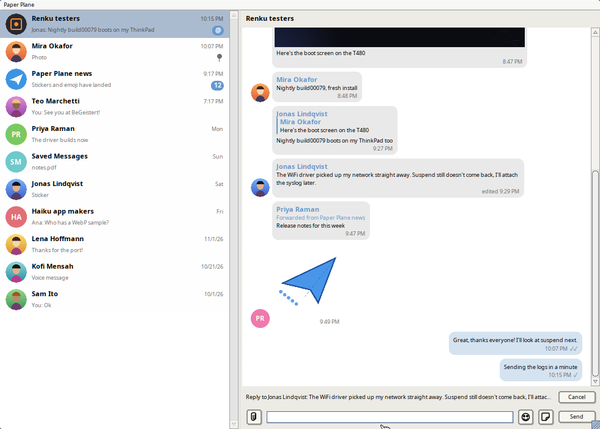
Replying: the message being answered is shown over the entry.

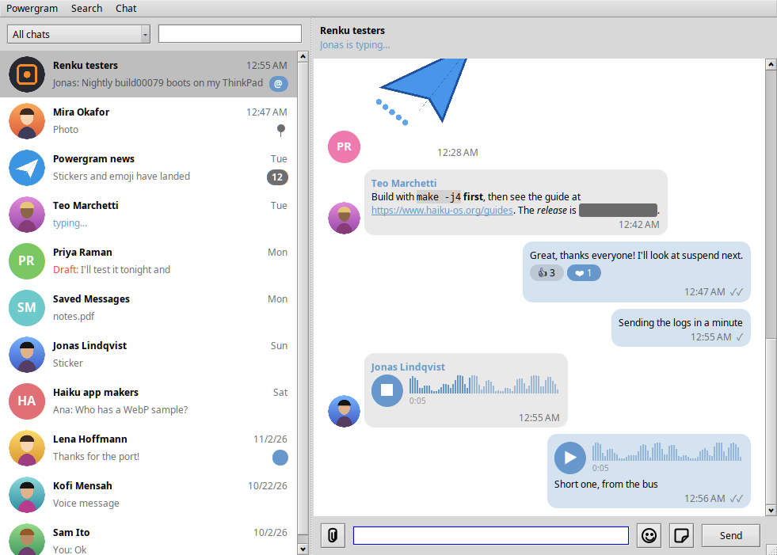
Voice messages play in the app; the waveform fills as they play.

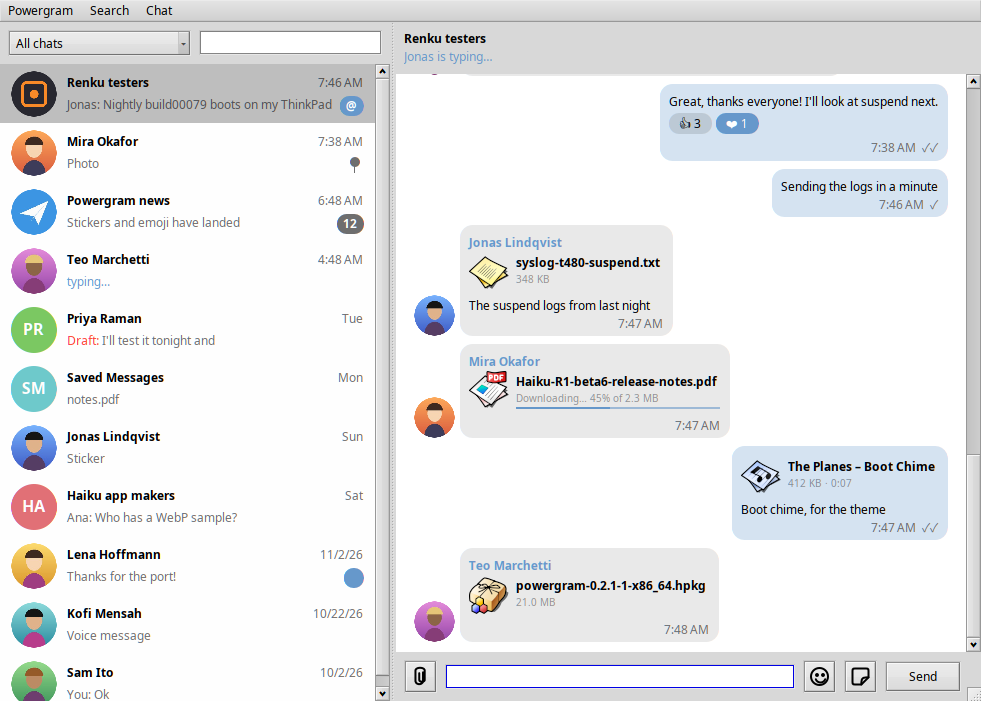
Files show their type's icon from Haiku's file types, and their progress while downloading.

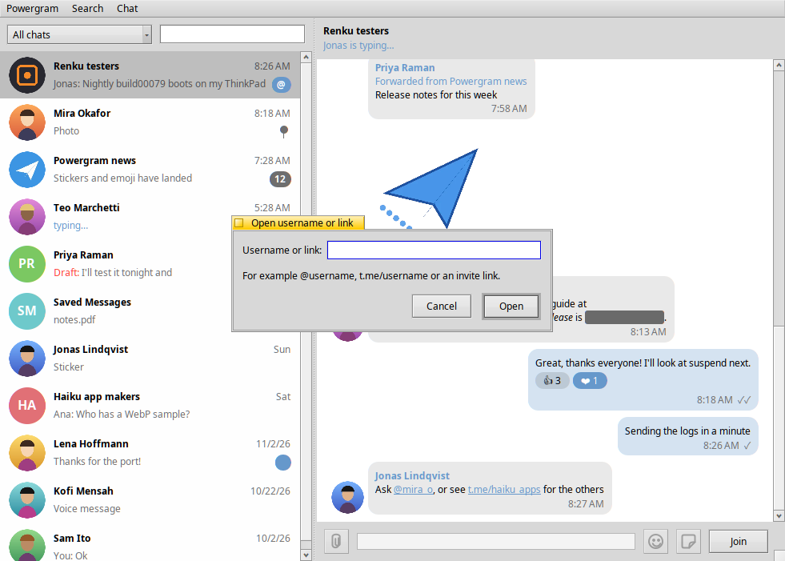
Mentions and t.me links open in the app; Cmd+O opens a typed username or link. In a group you're not in, Send becomes Join.

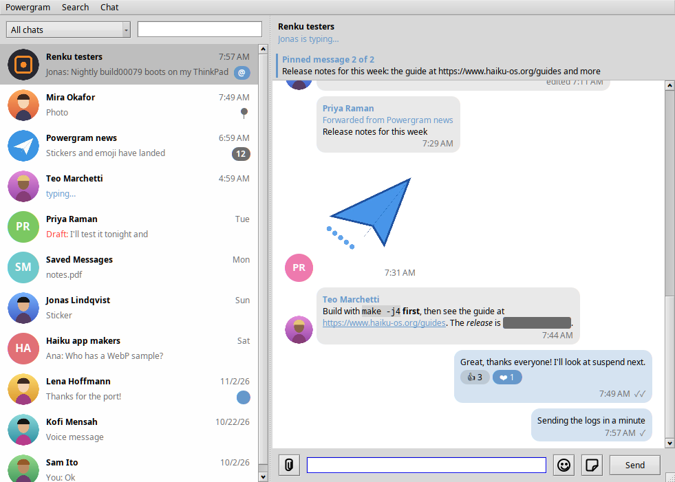
The pinned bar: click to jump to the message, and again for the next one.

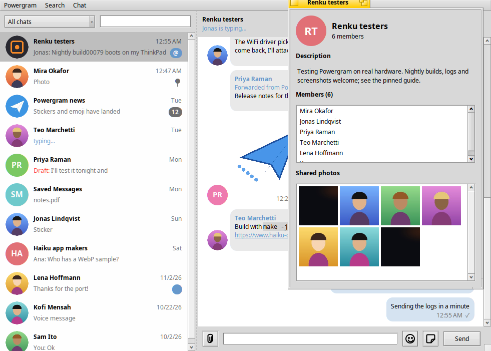
Chat info: the description, members and shared photos.

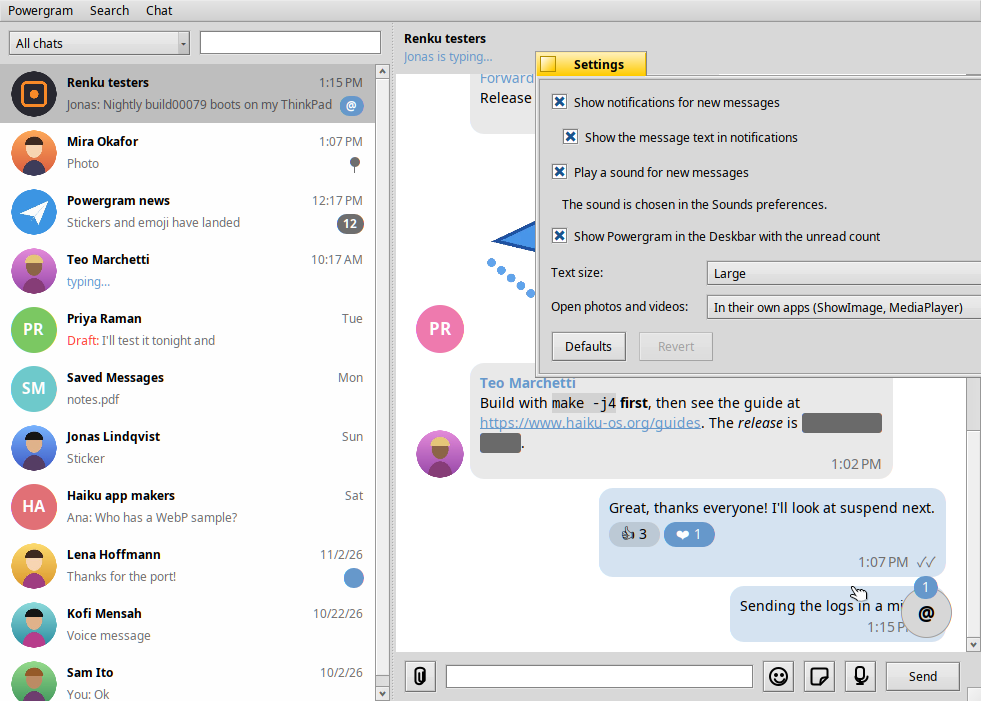
Settings apply at once; here the text size is Large.

## Platforms

| Platform | State |
|---|---|
| Renku OS / Haiku R1/beta6, x86_64 | Builds and runs |
| Haiku / Renku OS arm64 | Not yet: Renku's arm64 package repository has OpenSSL and zlib but no TDLib or noto_emoji yet, and HaikuPorts has no arm64 repository |
| Linux (Cosmoe) | Not yet |

## Building

On Haiku or Renku OS:

```sh
pkgman install tdlib openssl3_devel zlib_devel opus_devel libogg_devel
make
./Powergram
```

`sh packaging/build-hpkg.sh` builds the package.

HaikuPorts' TDLib is static only, so it's linked into the app; the result
needs only OpenSSL and zlib at run time. Install `noto_emoji` for emoji.

`make test` runs the core tests (login flow, chat list, history, throttling,
files and download progress, stickers, formatting, presence, voice, chat info,
links and usernames, pinned messages, voice recording, mentions) on any system with a C++17 compiler.
On Haiku, `make file-saving-test` checks saving received files and
`make voice-record-test` checks the voice message files it records and
`make media-probe-test` what files are sent as (photo, video or document).

## Your API key

Telegram wants every client to use an API ID of its own, and this app ships
none. At first start Powergram opens [my.telegram.org](https://my.telegram.org)
in your browser: log in, choose "API development tools", create an app, and
copy its api_id and api_hash into Powergram's window (pasting both lines at
once fills both fields). For scripted setups the key can instead go in a text
file `~/config/settings/Powergram/api_key`:

```
api_id=1234567
api_hash=0123456789abcdef0123456789abcdef
```

Powergram reads that file once, keeps the key in its own settings (readable
only by you) and deletes the file.

`--test-dc` connects to Telegram's test servers instead. Telegram no longer
accepts its `99966…` test numbers there; a test account has to be created
with an official mobile app first.

## Notes for Haiku developers

- HaikuPorts builds TDLib without threads (`TD_THREAD_UNSUPPORTED`), so
  `td_send` and `td_receive` must come from the same thread; `TdClient`
  queues requests for its one TDLib thread.
- `MessageView` sets `B_SCROLL_VIEW_AWARE`: without it `BScrollView` resets
  the scroll range from the view's preferred size whenever its height changes.
- Text is measured once per message with `BFont::GetEscapements`; measuring
  each candidate line with `StringWidth` stalled `app_server`.

## Licence

GPL-3.0-or-later (see `LICENSE`), as Paper Plane. Includes
[nlohmann/json](https://github.com/nlohmann/json) (MIT) in `third_party/`.
